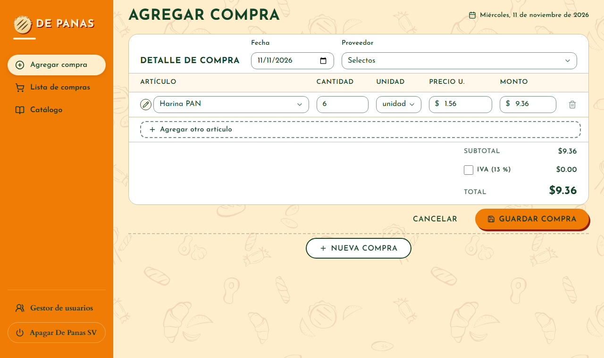
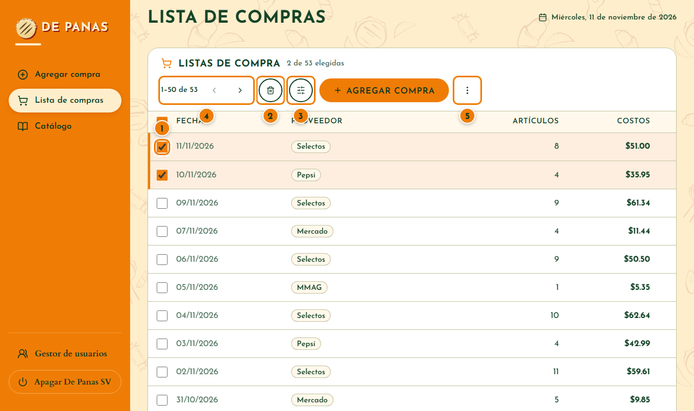
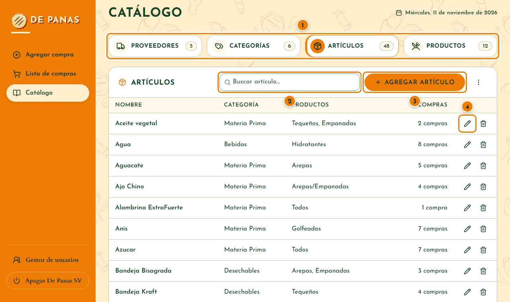
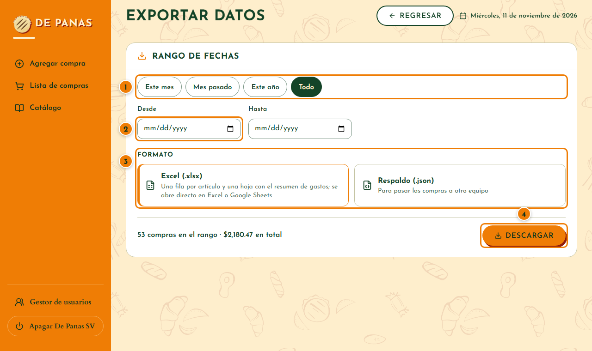

# De Panas — Registro de compras y costos

Aplicación web local para que **De Panas**, un negocio de comida venezolana en El Salvador, registre sus compras de insumos con proveedor, fecha, artículos y costo, y sepa cuánto gasta. Proyecto de Programación Orientada a Objetos del equipo **FORGE** (Instituto Kriete), con un cliente real.

## Documentación

| Para… | Abre |
|---|---|
| Conocer el proyecto: módulos, arquitectura, decisiones y calidad | **[docs/sitio/index.html](docs/sitio/index.html)** (en el navegador) |
| Usar la app | [docs/manual/index.html](docs/manual/index.html), el manual de uso |
| Instalarla en la computadora del cliente | [docs/INSTALACION_CLIENTE.md](docs/INSTALACION_CLIENTE.md) |
| Ver el modelo de datos y la capa DAO | [docs/MODELO_DATOS.md](docs/MODELO_DATOS.md) |
| Revisar la seguridad y sus pruebas | [docs/SEGURIDAD.md](docs/SEGURIDAD.md) |
| Respetar la marca | [DESIGN_DECISIONS.md](DESIGN_DECISIONS.md) |
| Programar en el proyecto | [CLAUDE.md](CLAUDE.md) y el `README.md` de cada carpeta de `frontend/src/` |

El índice completo de `docs/` está en [docs/README.md](docs/README.md).

## El problema y el cliente

- De Panas tiene local propio. Marta Martínez es la dueña principal y prepara la comida; César, socio, lleva la administración y es nuestro contacto.
- Su sistema de ventas solo tenía los productos. **No había un registro de compras de insumos**: qué se compró, a quién, cuánto y a qué precio. Las compras se llevaban en un Excel.
- Restricciones: sin presupuesto para hosting ni dominio, todo en dólares y en la computadora del local, sin internet.
- Requisitos y descubrimiento: [Documento de descubrimiento](Documento%20de%20descubrimiento%20-%20De%20Panas.pdf) y [Documento de requerimientos](Documento%20de%20requerimientos%20-%20De%20Panas.pdf). Sesiones con el cliente: [docs/PRUEBAS_USUARIO.md](docs/PRUEBAS_USUARIO.md).

## Qué hace

- **Agregar compra**, paso a paso: fecha y proveedor; luego los artículos (solo los que vende ese proveedor), con el precio de la última compra y el IVA de 13 %. Varias compras a la vez.
- **Lista de compras** con filtros, detalle para editar o eliminar, **casillas como en el correo** para eliminar varias y **páginas de 50** cuando las compras se acumulan.
- **Catálogo** de proveedores (con su ficha), categorías (con quién las vende), artículos (con su categoría y productos) y productos. Renombrar actualiza las compras.
- **Exportar** a Excel, con una hoja **Resumen** de gastos por proveedor, por categoría y por mes, o a un respaldo JSON. **Cargar datos** compara compra por compra.
- **Usuarios** con roles (administrador, operador y empleado), pantallas y funciones por persona, y requisitos de contraseña.
- **Seguridad real con el servidor**: sesión con token, permisos en cada petición, bloqueo tras 5 intentos y contraseñas con PBKDF2.
- **Versión .zip para Windows**: se abre como sitio web local, sin internet, e incluye una **versión de demostración** con dos meses de compras de ejemplo y el manual.

## Capturas

| Agregar compra | Lista de compras |
|---|---|
|  |  |

| Catálogo | Exportar datos |
|---|---|
|  |  |

## Tecnologías

| Parte | Tecnología |
|---|---|
| Frontend | React 18, Vite 5, React Router 6, Motion, lucide-react; CSS Modules con tokens de la marca |
| Backend | Node.js ≥ 22.13, Express 4, SQLite con `node:sqlite`; capa DAO en `backend/dao/` |
| Calidad | `node:test` (backend), Vitest + Testing Library (frontend), Playwright (de punta a punta), ESLint 9 con `jsx-a11y` |
| Entrega | .zip con el Node.js oficial firmado (`desktop/`) |

Cómo se aplicó la programación orientada a objetos (encapsulamiento en los DAO, herencia en `ErrorDatos`, abstracción en `services/api.js`…): [docs/sitio/arquitectura.html](docs/sitio/arquitectura.html#t-poo).

## Cómo ejecutarlo

Requisitos: Node.js ≥ 22.13 (por `node:sqlite`) y npm. Probado en Windows 11 con Node v24.

**Backend** (desde `backend/`):

```bash
npm install
npm start               # http://localhost:3000 (o npm run dev, con recarga)
npm test
npm run demo:base       # base de demostración en db/depanas-demo.db
```

**Frontend** (desde `frontend/`):

```bash
npm install
npm run dev             # http://localhost:5173 (redirige /api al backend)
npm run lint
npm run test:run
npm run test:e2e        # la primera vez: npx playwright install chromium
npm run build
```

**Versión para el cliente** (desde `desktop/`, en Windows): `npm install`, `npm run preparar` y `npm run dist`. Detalle en [desktop/README.md](desktop/README.md).

Sin el backend, el frontend trabaja en modo local con datos de ejemplo. Usuarios iniciales: `Cesar_01` (administrador) y `Marta_02` (operadora), los dos con `DePanas#2026`. Cámbialas en el Gestor de usuarios.

## Estructura

```
frontend/src/   pages, components (common = UI base), context, hooks, services/api.js, utils, styles
backend/        app.js, routes/ (HTTP), dao/ (acceso a datos), db.js y db/ (esquema, catálogo inicial, demo), test/
shared/         reglas que usan igual backend y frontend (compras, IVA, archivo, gastos, usuarios…)
desktop/        la versión .zip para Windows
docs/           documentación, manual de uso y sitio de documentación
.claude/skills/ skills del proyecto (marca, diseño, backend, seguridad, auditorías)
```

## Equipo FORGE

| Integrante | GitHub | Rol |
|---|---|---|
| Gabriel Valencia | [@Gabrielvalen08](https://github.com/Gabrielvalen08) | Formulario de compras y entrega al cliente |
| Pedro Rodríguez | [@PedroR007102](https://github.com/PedroR007102) | Datos y catálogo |
| Alejandro Salgado | [@alsalgado-24](https://github.com/alsalgado-24) | Usuarios, seguridad y calidad |
| Soham Villacorta | [@casoham](https://github.com/casoham) | Enlace con el cliente e integración |

Los aportes de cada uno están en [docs/sitio/index.html](docs/sitio/index.html#t-equipo).

## Flujo de trabajo

- Una rama por cambio y Pull Request hacia `main`.
- Commits en español con prefijo y área: `feat(compras): …`, `fix(agregar-compra): …`, `docs: …`, `test: …`.
- Antes de un PR: `npm run lint`, `npm run test:run`, `npm run test:e2e` y `npm run build` en `frontend/`, y `npm test` en `backend/`.

## Estado

**Lista para que la usen César y Marta.** 594 pruebas automáticas: 131 del backend, 373 del frontend y 90 recorridos en navegador.

Para después: conversión automática de unidades (HU-02), un panel de costos y márgenes dentro de la app y el acceso desde la tablet por la red local.
